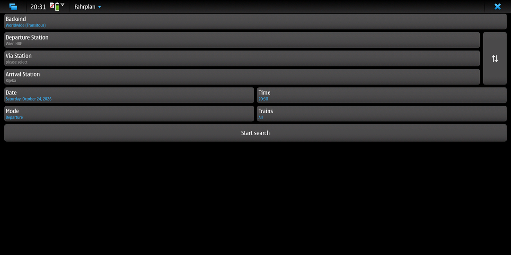
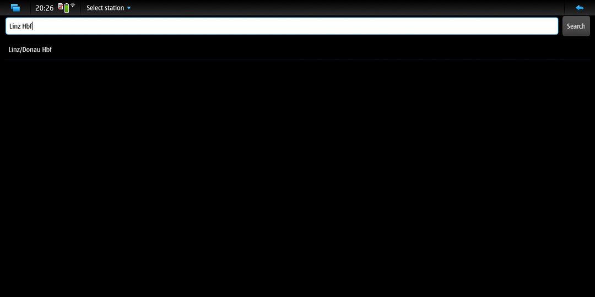
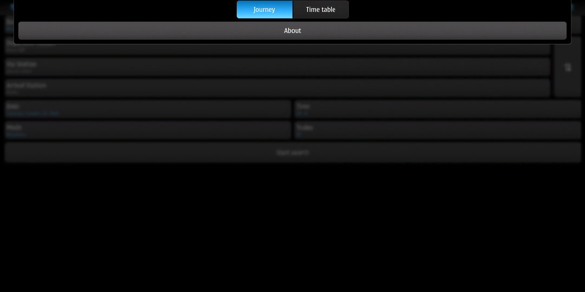
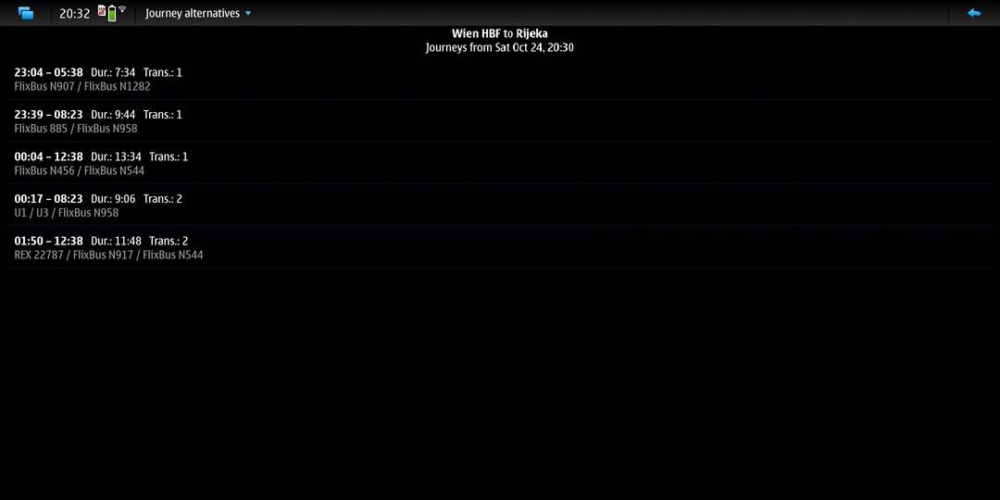
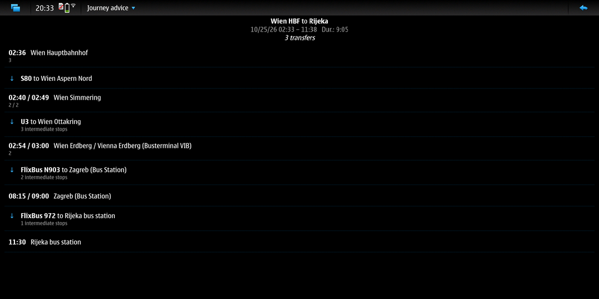

# Fahrplan for Maemo Leste

A public transport journey planner and timetable for
[Maemo Leste](https://maemo-leste.github.io), built for arm64 devices such as
the F(x)tec Pro1X (Leste "daedalus", Devuan 5 / Debian bookworm, Qt 5,
Hildon desktop).

It is Fahrplan 2 -- the app that started on Maemo 5 and went on to MeeGo
Harmattan, Symbian, BlackBerry 10, Ubuntu Touch and Sailfish OS -- with all the
backends of its MeeGo Harmattan port, and a new Hildon user interface that
follows the Fahrplan that Maemo 5 had: picker buttons for the stations, date,
time and options, results and details in stacked windows, and the Hildon
application menu.

| | |
| --- | --- |
|  |  |
|  |  |

## Install

Download the `.deb` from the
[releases](https://github.com/smatkovi/fahrplanMaemoLeste/releases) and install
it on the device:

    sudo apt install ./fahrplan2_2.0.52-leste1_arm64.deb

Fahrplan then appears in the application menu. All its dependencies are part
of a standard Leste installation (`qt-platform-maemo`, `qt5-style-plugins`,
`liblocation0`).

## Using it

* **Backend** -- the data source; tap it to pick one of the backends below.
* **Departure / Via / Arrival station** -- opens the station search. Without
  a search term it lists your favourites; tap and hold a station to add it to
  or remove it from the favourites. The application menu of that window also
  has *Stations nearby (GPS)* (for backends that support it) and *Clear
  station*. Tap and hold a station button on the main window to clear it or
  to swap it with another one; the ⇅ button swaps departure and arrival.
* **Date, Time, Mode** -- *Departure*, *Arrival*, or *Now*.
* **Trains** -- restrict the means of transport, if the backend can.
* The application menu switches between **Journey** (connections from A to B)
  and **Time table** (the departures or arrivals of one station).
* In the results, the application menu has **Earlier** and **Later**; tap a
  connection for its details: every station with times and platforms and the
  trains in between.

## Backends

| Backend | Journey | Via | Time table | Stations nearby |
| --- | --- | --- | --- | --- |
| Germany (bahn.de) | yes | yes | yes (with direction) | yes |
| Austria (oebb.at) | yes | yes | yes | yes |
| Austria, Salzburg (svv-info.at) | yes | yes | yes | yes |
| Germany, Munich (mvv-muenchen.de) | yes | yes | yes | yes |
| Germany, Rhine Ruhr (vrr.de) | yes | yes | yes | yes |
| Switzerland (timetable.search.ch) | yes | yes | yes | yes |
| Denmark (rejseplanen.dk) | yes | yes | yes | yes |
| Norway (reiseinfo.no / nri) | yes | yes | yes | yes |
| Sweden (resrobot.se) | yes | yes | yes (with direction) | yes |
| Sweden (vasttrafik.se) | yes | yes | yes | yes |
| Finland (matka.fi) | yes | yes | yes (with direction) | yes |
| Netherlands (9292) | yes | -- | -- | -- |
| Ireland (transportforireland.ie) | yes | yes | yes | yes |
| Australia, Sydney (transportnsw.info) | yes | yes | yes | yes |
| Australia, Victoria (ptv.vic.gov.au) | yes | yes | yes | yes |
| Worldwide (Transitous) | yes | yes | yes | yes |

(`tools/leste-probe --list` prints this from the code.) The services change
their interfaces now and then; the release notes say which backends were
tried on a device for a given release.

## Not yet

* Adding a journey to the calendar. The Harmattan port used QtOrganizer,
  which does not exist for Qt 5 on Leste; the Maemo calendar
  (`calendar-backend`, used by qalendar) would be the way to do it.
* *Stations nearby* uses liblocation; it builds and starts, but has not been
  tried with a GPS fix on a device yet.
* Translations: the strings shared with the Harmattan pages use their
  existing translations (17 languages); the few new ones are English only.
* On a high resolution screen such as the Pro1X's the Hildon theme -- and so
  this application, which follows it -- is drawn at N900 pixel sizes; that is
  a matter of the theme, not of Fahrplan.

## Building

The package is built in an arm64 Maemo Leste root file system, on the device
or -- much faster to set up, though compiling runs under emulation -- in a
chroot on an x86_64 Linux host with `qemu-user-static` and binfmt_misc.

### In a chroot on a PC

1. Get a Leste arm64 root file system, for example the one of an official
   arm64 image (or the image of your device), loop-mount it and bind-mount the
   virtual file systems:

        sudo mount -o loop maemo-leste.img /mnt/leste
        for d in proc sys dev dev/pts; do sudo mount --bind /$d /mnt/leste/$d; done
        sudo cp /etc/resolv.conf /mnt/leste/etc/resolv.conf   # if it is a plain file there

   Work on a copy of the image, not on the one you boot.

2. Make sure the kernel runs aarch64 binaries through the *static* qemu
   (`/proc/sys/fs/binfmt_misc/qemu-aarch64` must name
   `qemu-aarch64-static`, with the `F` flag); a dynamically linked qemu does
   not find its libraries inside the chroot.

3. Install the build dependencies (Leste pins its own repositories, so `apt`
   picks the Leste versions of Qt and QtMaemo5):

        sudo chroot /mnt/leste apt-get update
        sudo chroot /mnt/leste apt-get install --no-install-recommends \
            build-essential debhelper fakeroot qtbase5-dev qtbase5-dev-tools \
            qttools5-dev-tools libqt5maemo5-dev libqt5x11extras5-dev \
            liblocation-dev libglib2.0-dev zlib1g-dev pkg-config

4. Copy the source into the chroot and build the package:

        sudo cp -r fahrplanMaemoLeste /mnt/leste/root/
        sudo chroot /mnt/leste sh -c 'cd /root/fahrplanMaemoLeste && dpkg-buildpackage -b -us -uc'

   The package lands next to the source directory, in `/mnt/leste/root/`.

### On the device

Install the same build dependencies with `sudo apt install` and run
`dpkg-buildpackage -b -us -uc` in the source directory.

### Without packaging

    qmake CONFIG+=leste && make
    QT_QPA_PLATFORM=maemo QT_STYLE_OVERRIDE=maemo5 ./fahrplan2

`CONFIG+=leste` is also detected automatically when the QtMaemo5 headers
(`libqt5maemo5-dev`) are installed.

## Trying a backend without the user interface

`tools/leste-probe` drives a backend the same way the application does
(through the `Fahrplan` object and its parser thread) and prints what comes
back -- handy on the device over ssh:

    cd tools/leste-probe && qmake && make
    ./leste-probe --list
    ./leste-probe Austria "Wien Hbf" "Linz Hbf"
    ./leste-probe --timetable Germany "Berlin Hbf"

It keeps its settings apart from those of the application.

## How the port works

* `src/gui/leste/` is the new user interface: QWidget windows with the
  QtMaemo5 widgets that Leste provides for Qt 5 (`QMaemo5ValueButton`,
  the date / time / list pick selectors, `QMaemo5InformationBox`).
* Hildon window features come from the Leste platform plugin
  (`qt-platform-maemo`) through dynamic properties instead of the Qt 4 widget
  attributes: `X-Maemo-StackedWindow`, `X-Maemo-Orientation`,
  `X-Maemo-Progress`. The menu bar of a `QMainWindow` becomes the Hildon
  application menu, an exclusive `QActionGroup` its filter buttons.
* The rest -- the `Fahrplan` object, the models and every parser -- is the
  code of the MeeGo port, built in its Qt 5 flavour (`BUILD_FOR_QT5`).
* Stations nearby use liblocation, so the positioning methods chosen in the
  Location settings apply.
* The application runs with `QT_XCB_NO_XI2=1` (set in `main.cpp`; `FAHRPLAN_XI2=1`
  keeps XInput2). The touch screen is an X input device that MCE disables
  while the display is blanked, and the XInput2 code of the Leste platform
  plugin aborts on the next touch from a device it has not registered
  (`ASSERT: "dev"` in `xi2ProcessTouch`). Without XInput2 the touches arrive
  as ordinary pointer events, as they did for Qt 4 on Maemo 5.
* `FAHRPLAN_GRAB=/tmp/fahrplan.png fahrplan2` saves the top window every two
  seconds -- a way to get screenshots of the application where no screenshot
  tool is installed.
* The backend list in `src/fahrplan_backend_manager.cpp` and the switch in
  `src/fahrplan_parser_thread.cpp` have to count the same way; new backends
  go at the end of both.

## History and credits

Fahrplan was written by Philipp Andreas (smurfy) and is maintained by Mark
Washeim (poetaster), Philipp Andreas (smurfy), Michael Stevens (stevensmi) and
Oleksii Serdiuk (leppa), with code from many contributors (see
`src/gui/about.js`) and translations by the Transifex community:
[poetaster/fahrplan](https://github.com/poetaster/fahrplan).

* The first Fahrplan for Maemo 5 (by smurfy and CaCO3, a QWidget app) is kept
  on the branch [`fahrplan1`](https://github.com/smatkovi/fahrplanMaemoLeste/tree/fahrplan1)
  of this repository; it was the earlier attempt at Leste and is what the
  look of this port is modelled on.
* The backends come from the MeeGo Harmattan port,
  [smatkovi/fahrplanMeegoHarmattan](https://github.com/smatkovi/fahrplanMeegoHarmattan),
  which brought Fahrplan 2 back to Qt 4.7 and added and fixed backends (DB,
  9292, Transitous, ...). Its history is the history of this branch.

Data: the transitous.org services are provided with the assistance of
[transitous sources](https://transitous.org/sources/); Transitous and Fahrplan
use data from the OpenStreetMap project
([copyright and attribution](https://www.openstreetmap.org/copyright));
Netherlands journey data from [9292](https://9292.nl) (REISinformatiegroep B.V.).

## License

GNU General Public License, version 2 or later (see `COPYING`).
`3rdparty/gauss-kruger-cpp` is under the Boost Software License 1.0.
